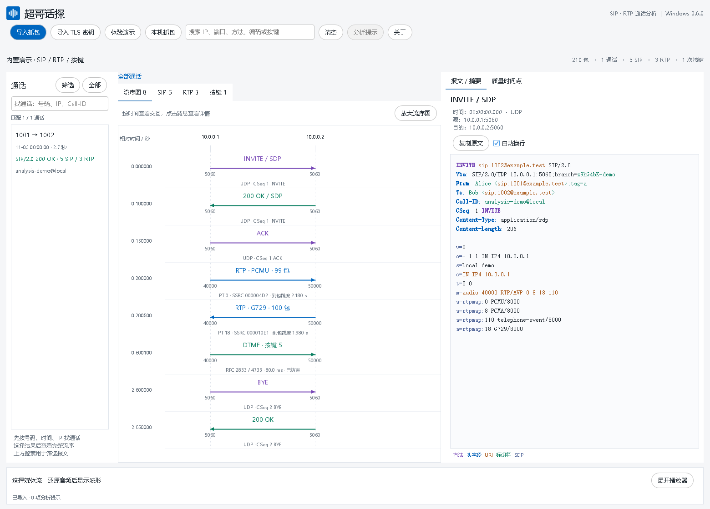
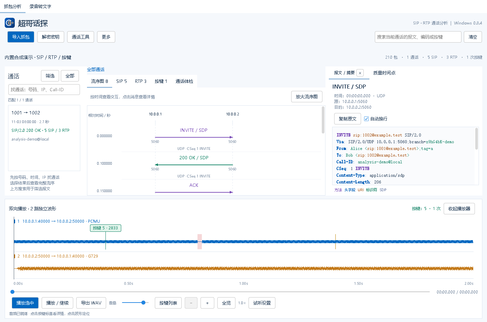
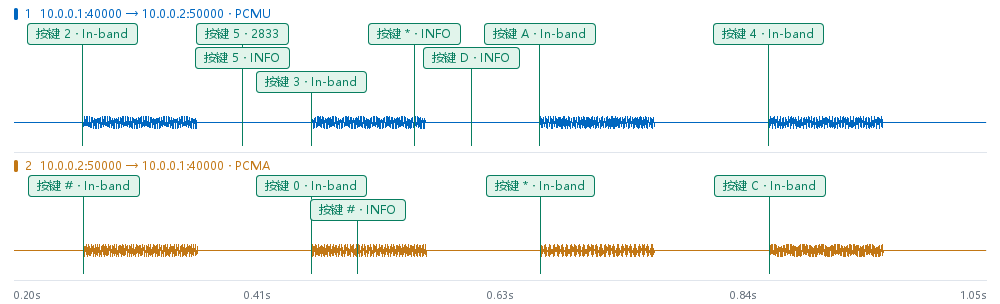
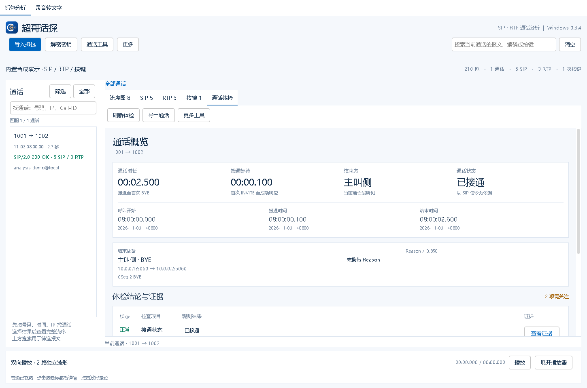
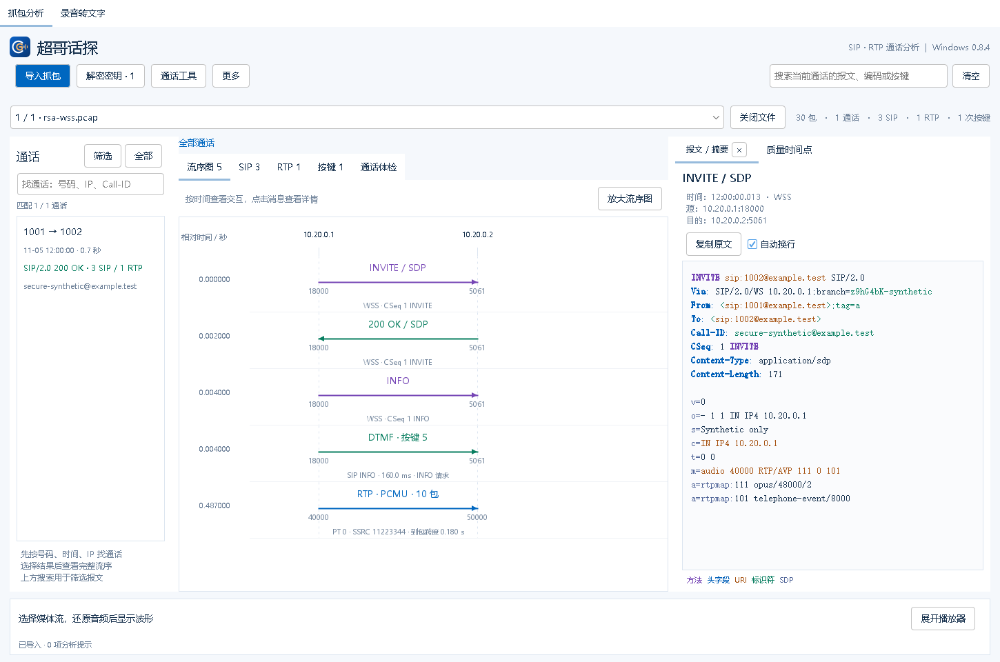
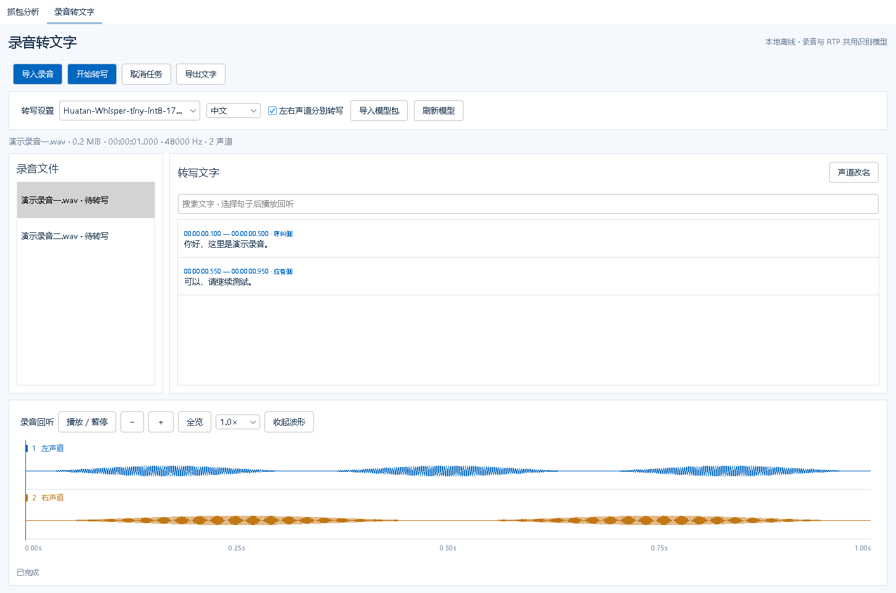

# 超哥话探 · Windows

**SIP · RTP 通话分析**，适用于 Windows 10 / 11 64 位，文件分析和语音识别均在本机完成。

[下载便携版](https://github.com/Liuchao-6/rtp-scope-windows/releases/download/v0.8.5/ChaogeHuatan-0.8.5-win-x64.zip) · [离线语音模型](https://github.com/Liuchao-6/rtp-scope-windows/releases/download/v0.8.4/Huatan-SenseVoice-int8.zip) · [Android 版](https://github.com/Liuchao-6/rtp-scope-android) · [反馈](https://github.com/Liuchao-6/rtp-scope-windows/issues)

**0.8.5 更新**：修复 RTP 时间戳未反映实际停顿时，两路通话录音逐渐错位的问题；试听、波形、按键和 WAV 导出同步校正。升级后重新导入抓包，旧索引会自动重新分析，离线模型无需重新下载。

## 解决的痛点

| 痛点 | 解决方式 |
| --- | --- |
| 看信令、媒体、按键和导出录音，需要切换多个入口 | 按通话汇总 SIP、RTP 和按键，集中查看流序图、试听并导出 WAV。 |
| TLS / WSS 信令解密配置门槛高 | 分别导入抓包与 RSA 私钥或 TLS key log，简化支持范围内的信令还原。 |
| tcpdump 抓包包含大量通话，目标通话难找 | 按主被叫号码、时间和 IP 查找通话，联动查看对应信令与媒体。 |
| 临时没有电脑时，抓包核查不便 | 日常以 Windows 电脑分析为主；外出或身边没有电脑时，可用 Android 手机查看信令、试听通话和核对按键，作为临时补充。 |
| IVR 按键传输方式不同，容易漏查 | 统一展示 RFC 2833 / 4733、SIP INFO 和 In-band DTMF，标明类型、方向与时间。 |
| 卡顿、断续位置难找，录音与报文难对应 | 双向波形支持缩放，结合序号缺口和到达延迟标记，辅助定位抓包可见的异常。 |
| 通话时间、时长和结束方需要逐包整理 | 通话体检集中显示开始、接通、结束时间、时长和结束发起侧，证据不足时显示未知。 |
| 长录音查找内容费时 | 通话与本地录音可离线转文字，按媒体方向或声道分别识别，支持关键词搜索和对应片段回听。 |
| 排障材料整理、交接麻烦，报告含敏感信息 | 导出 HTML 报告、关联抓包和录音；报告中的号码与 IP 可分别选择遮蔽。 |

## 主要功能

- **信令与按键**：PCAP / PCAPNG、多文件独立切换，按号码 / 时间 / IP 查找通话；SIP 流序图、彩色报文、RFC 2833 / 4733、SIP INFO 和 In-band DTMF。
- **通话体检**：开始、接通、结束时间、时长、结束发起侧、Reason / Q.850，以及信令与媒体问题的证据。抓包缺少结束时，完整时长与挂断方显示未知。
- **通话资料**：按需导出原始关联 PCAPNG、各方向 WAV 和 HTML 报告；报告可分别选择遮蔽号码、IP；单项或单方向失败后继续导出其余内容，并列出结果。
- **抓包对照与关联**：对照两个抓包的同一 SIP 事务，手动校准时间；查看 Replaces / Join / Refer-To 证据与候选通话段，手动确认、移除或定位。
- **大文件**：单文件至 1 GiB，分阶段进度、取消导入和解析索引复用；中断抓包分析已写入的内容。
- **双向试听**：分路波形、缩放、收起、缺包与延迟标记；独听、静音、左右声道、0.5～2 倍速和 A/B 循环。兼容 RTP 时间戳异常跳变或持续落后，结合抓包时间恢复必要间隔，保留短暂网络抖动的原始播放节奏。
- **媒体编码**：G.711、G.729 / G.729A、Opus、G.722，以及常用 AMR-NB / AMR-WB RTP 封装。
- **离线转文字**：RTP 通话和本地录音共用模型，双向 / 双声道分别识别，支持文字搜索、回听、TXT / SRT 合并或分声道导出。

## 使用

1. 完整解压便携 ZIP，双击 `ChaogeHuatan.exe`，无需另装 Java。
2. 导入或拖入抓包，先在左侧找通话，再查看流序图、媒体或「通话体检」。可以先体验合成演示。
3. 双击媒体流显示波形；「试听设置」控制方向、声道、倍速及循环。「导出 WAV」生成一个文件，每路方向独立声道，按波形从上到下排列并按抓包时间对齐；试听静音和倍速不改变导出内容。
4. 转写前下载配套模型 ZIP，在「录音转文字」中「导入模型包」，无需解压。再导入录音，或从 RTP 页「转写当前通话」。

录音支持 WAV、MP3、M4A / AAC、FLAC，最长 60 分钟。配套推荐 SenseVoice Small int8，中文结果统一转为简体，仍可切换 Whisper；也可导入同一套 encoder、decoder 与 tokens 的 Whisper base ONNX ZIP。时间戳表示原录音中的语音片段范围，不保证逐字对齐，识别内容请回听确认。

## 界面

以下截图与波形使用合成演示数据。

**SIP 流序与彩色报文**

**双向 RTP 波形**：上下分路，标记按键、缺包与到达延迟。

**三类按键**：区分 RFC 2833 / 4733、SIP INFO 和 In-band DTMF。

**通话体检**：时间、时长、结束方及信令 / 媒体证据。

**RSA / TLS / WSS**：分别导入抓包与密钥，查看还原后的 SIP。

**录音转文字**：按声道查看、搜索、回听与导出。

## 解密与使用范围

- PCAP、RSA 私钥和 NSS TLS key log 分别导入。RSA 支持未加密 PKCS#1 / PKCS#8 `.key / .pem / .der`，适用于 TLS 1.0～1.2 RSA 密钥交换；ECDHE / TLS 1.3 需会话 key log。两类密钥仅保留在当前会话内。
- 支持 SIP over WS / WSS、掩码、分片与 permessage-deflate；不解密 SRTP，不支持加密私钥、TLS 再协商或厂商自定义 JSON 信令。
- G.722 支持常见 64 kbit/s；AMR 支持单声道 octet-aligned / bandwidth-efficient，不支持 CRC、robust sorting、交织封装。
- 播放器 WAV 导出支持 1～64 声道、最长 60 分钟、RIFF 4 GiB 上限；超过双声道使用扩展 PCM WAV。普通播放器可能合并播放，支持多声道的音频工具可逐路查看。
- TCP / TLS 单通话导出会包含完整关联连接，同连接可能存在其他通话。报告遮蔽不改变原始 PCAP 和音频。
- 对照未见、序号缺口与到达延迟只反映当前抓包所见；候选关联不等于已确认同一通话，声道不等于人物身份。
- 未加载解密密钥时复用解析索引；文件、解析版本或密钥变化时重新分析。索引存于用户目录 `.chaoge-huatan/index`，最多约 2 GiB；媒体临时缓存另需预留空间。
- 最多 2000 万包、3 万条 SIP 消息，TCP 重组上限 24 MiB。离线分析无需 Wireshark；「本机抓包」需另装 tshark / Npcap。

## 构建

Windows、Python 3.11、项目本地 Java 8 工具链；依赖来源和校验值见 `third_party`。运行 `python tools/build.py`；只跑测试使用 `--test-only`。模型单独打包，不嵌入应用。便携包不包含开发 Markdown 文档。

[第三方许可](THIRD_PARTY_NOTICES.md) · [验证范围](VALIDATION.md)
