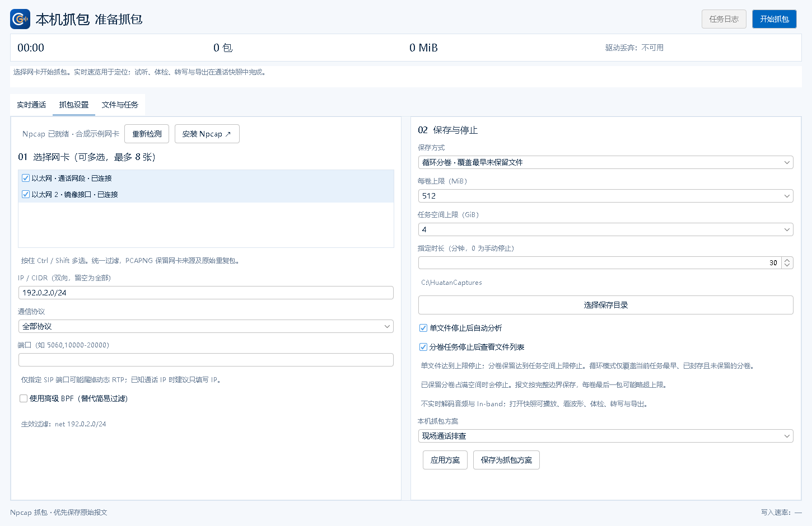
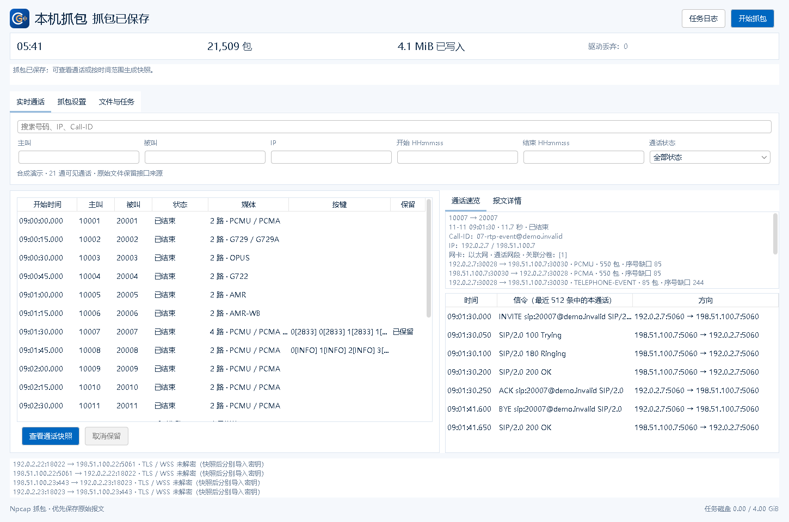
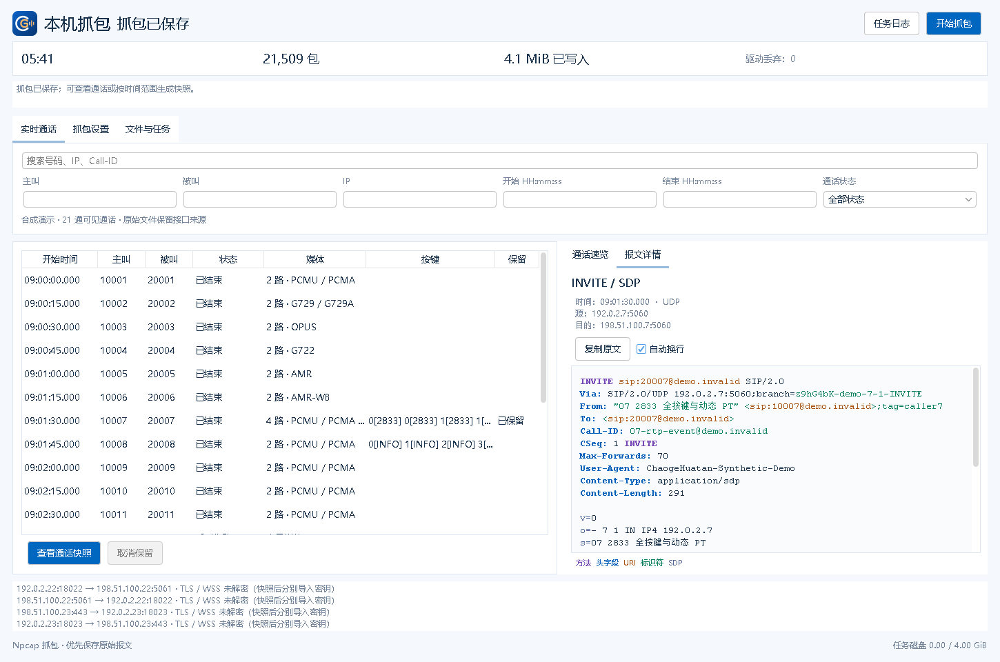
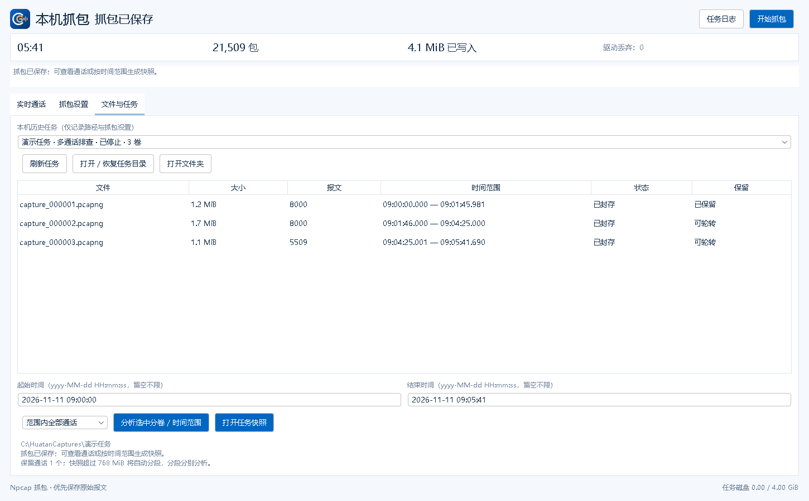

# Windows 本机抓包使用指南

[返回项目首页](../README.md)

适用于 **0.10.0** 的 Windows 本机抓包功能。下载入口见 [项目首页](../README.md)。

操作顺序：**设置网卡与保存方式 → 开始抓包 → 查找目标通话 → 查看分析快照 → 停止或回看任务**。配图由当前版本界面渲染，使用合成示例通话、网卡与任务状态。

## 1. 准备与抓包设置

从 [Npcap 官网](https://npcap.com/#download) 安装驱动，进入「本机抓包 → 抓包设置」，点击「重新检测」。本应用自带抓包组件，无需配置 Wireshark 或 tshark；软件包不附带 Npcap 安装器、SDK、DLL 或驱动。

1. 选择实际经过通话的网卡，按住 Ctrl / Shift 可多选，最多 8 张。所有网卡共用一套过滤条件。
2. 已知通话 IP 时，可填写单个 IP 或 CIDR，例如 `192.0.2.10`、`192.0.2.0/24`，同时匹配收发两个方向。端口支持列表和范围，例如 `5060,10000-20000`。全部留空时保存所选网卡的全部流量。
3. 选择保存目录、保存方式、每卷上限和停止时长，然后点击顶部「开始抓包」。默认目录为文档目录下的「超哥话探\抓包」，每次建立独立任务目录。

SIP 端口与 RTP 媒体端口通常不同。只填写 `5060` 可能只有信令而没有录音；不确定媒体端口时，可先按通话 IP 过滤。勾选「使用高级 BPF」后，BPF 会替代简易条件；表达式无效时不会开始抓包。

### 选择保存方式

| 保存方式 | 到达上限后的行为 | 适用情况 |
| --- | --- | --- |
| 单文件 | 达到每卷上限停止，可选择停止后自动分析 | 一次短时间复现 |
| 分卷保留 | 持续生成文件，达到任务空间上限停止 | 保留排障期间全部报文 |
| 循环分卷 | 覆盖当前任务最早、已封存且未保留的文件 | 等待偶发故障，控制磁盘占用 |

每卷可选 **128 / 256 / 512 / 768 MiB**，分卷任务空间可选 **2 / 4 / 8 / 16 GiB**。指定时长为 `0` 时手动停止，填写分钟数后到时停止；空间或文件上限可能先触发停止。报文按完整边界保存，每卷最后一包可能略超每卷上限。

经常使用同一组网卡和过滤条件时，点击「保存为抓包方案」。下次选择方案并点击「应用方案」，检查网卡是否仍可用后开始抓包。方案只保存本机设置，不保存信令正文或解密密钥。

## 2. 查找目标通话

「实时通话」将可识别的 SIP 按 Call-ID 汇总。顶部可搜索号码、IP、Call-ID，也可组合主叫、被叫、IP、时间与状态；多个条件同时匹配。时间按当前电脑时区，可输入 `09:01:00`。

点击左侧一通通话，右侧显示通话信息、网卡来源、关联分卷、RTP 方向与编码。左侧「按键」列标出按键类型，例如 `5[2833]`、`#[INFO]`。右侧信令列表显示任务最近 512 条信令中属于该通话的内容；速览中的长报文可能截取。

点击右侧信令行，会切换到「报文详情」，查看时间、源 / 目的 IP 与端口、彩色报文，支持自动换行和复制原文。

### 实时速览与完整分析

| 内容 | 抓包中的实时速览 | 打开快照后的完整分析 |
| --- | --- | --- |
| SIP | 通话汇总、最近信令与报文详情 | 流序图、信令筛选及通话工具 |
| RTP | 方向、编码、包数与序号缺口 | 解码试听、波形、质量标记和 WAV 导出 |
| 按键 | RFC 2833 / 4733、SIP INFO | 额外检测 In-band，按时间与方向查看 |
| TLS / WSS | 显示加密连接线索 | 分别导入 RSA 私钥或 TLS key log 后分析 |
| 体检、转写 | 在快照中进行 | 通话体检、离线转写及资料导出 |

多网卡抓到的近时重复报文在速览中合并，原始 PCAPNG 仍保留每个报文及接口来源。序号缺口可能被后续乱序包补齐。速览落后或达到上限时会显示提示，原始报文保存独立进行。

## 3. 保留通话与打开快照

抓包仍在进行时，选中目标通话后可执行：

- **保留通话**：保护已存在的关联分卷，并持续保护后续相关分卷至识别到通话结束后 2 秒。TCP 通话额外保留此前的连接上下文。再次点击「取消保留」后，这些分卷重新受循环覆盖规则控制。
- **查看通话快照**：复制截至当前完整报文边界的关联数据，加入分析工作区并优先选中目标通话，原任务继续抓包。

快照生成后，进入原有分析工作区播放双向音频、查看波形、核对按键、体检或转写。快照标明报文截止时间，后续抓到的数据不会自动追加；需要更新时再生成快照。

已循环覆盖的前段无法恢复。未捕获到结束信令或速览尚未追上时，通话保留可能持续；保留分卷占满预算后，任务会停止保存。TCP / TLS 快照为了保留重组与解密上下文，可能包含同连接的其他通话。

## 4. 分卷、时间范围与历史任务

在「文件与任务」查看文件大小、报文数、时间范围、封存与保留状态。图中的分卷和任务状态为合成示例。

| 入口 | 用法 |
| --- | --- |
| 打开任务快照 | 使用当前任务仍保留的全部分卷生成快照 |
| 分析选中分卷 / 时间范围 | Ctrl / Shift 多选分卷，可再填写起止时间；不选分卷时使用当前任务全部分卷 |
| 范围内当前选中通话 | 先在「实时通话」选择通话，再切换此选项，限制快照的通话范围 |
| 本机历史任务 | 停止当前抓包后，选择此前任务回看 |
| 打开 / 恢复任务目录 | 选择含 `capture_000001.pcapng` 等分卷的任务目录，打开或恢复已写入的完整报文 |
| 任务日志 | 查看当前任务的开始、分卷、循环覆盖、保留与停止记录 |

范围时间填写 `yyyy-MM-dd HH:mm:ss`，例如 `2026-11-11 09:01:00`，留空表示不限制该端时间。已选分卷与时间条件共同生效；TCP 通话快照会额外保留相关连接上下文，因此可能超出所选分卷或时间范围。

快照超过 **768 MiB** 自动分段，每段独立加入分析列表，跨段通话可能不完整。手动导入的多个抓包仍分别分析，只有同一抓包任务的分卷参与本节的任务快照。

恢复只读取原始分卷中完整、可解析的报文边界，不改写或截断原文件，也不会自动重新开始抓包。历史任务记录不保存解密密钥，需要时在分析页重新导入。

## 5. 常见问题

**只有 SIP，没有 RTP 或录音？**

先检查网卡与过滤条件。媒体 IP 或端口可能与 SIP 不同，尝试取消 SIP 端口限制；也可在实时页查看未关联 RTP 提示。完整试听、In-band 检测和质量分析需要打开快照。

**TLS / WSS 为什么暂时没有号码？**

加密信令在实时阶段只能显示连接线索。打开任务快照后，分别导入适用的 RSA 私钥或 TLS key log；解密仍受握手完整性及密钥类型限制。SRTP 媒体暂不解密。

**为什么循环模式停止了？**

检查任务状态和日志。保留分卷占满空间、无法释放文件、写盘异常、分卷数量上限或到达指定时长都可能停止任务；软件不会为腾空间覆盖已保留文件。

**驱动丢弃与 RTP 缺口有什么区别？**

驱动丢弃表示抓包侧报告的丢弃；写盘队列丢弃表示报文没有进入保存队列；达到保存上限后的未写入包单独显示。RTP 序号缺口来自当前抓到的媒体序列，可能与上游丢包、抓包不全或乱序有关，不能直接等同于实际听感。

**抓包时能隐藏窗口或退出吗？**

可以切换工作区或隐藏到托盘，当前任务继续。托盘菜单可「停止并保存」；退出时会提示先停止并等待保存。Npcap 权限受限时，可按提示仅为抓包组件申请管理员授权。

实现验证与待实测范围见 [验证说明](../VALIDATION.md)。
